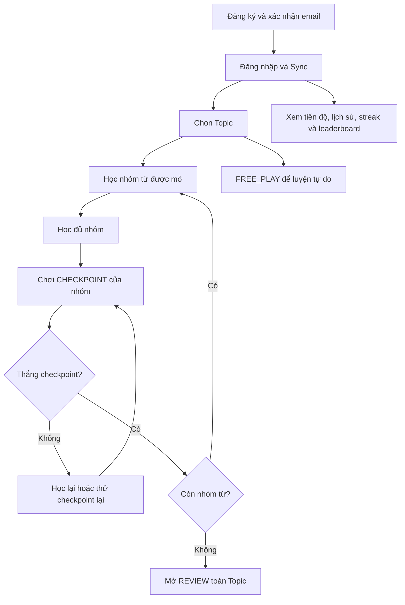
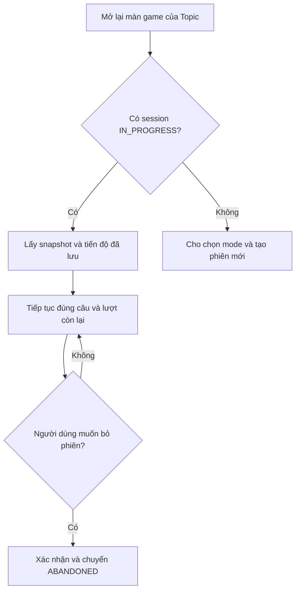

# Flow nghiệp vụ — Người dùng đi qua hệ thống như thế nào?

Ngày đối chiếu: **04/11/2026**. File này tập trung hành trình của người dùng; endpoint cụ thể nằm trong 04_FLOW_API.md.

## 1. Hành trình tổng quát

FREE_PLAY là nhánh luyện riêng. Chơi FREE_PLAY không tự thay thế việc học tuần tự và thắng CHECKPOINT để mở REVIEW.

## 2. Đăng ký, xác nhận và đăng nhập

1. Người dùng nhập email, mật khẩu, displayName để đăng ký.
2. Cognito quản lý tài khoản và gửi mã xác nhận theo cấu hình dịch vụ.
3. Người dùng nhập mã để xác nhận. Chưa nhận mã thì dùng gửi lại mã; không mặc định HTTP 200 của gửi lại mã luôn chứng minh có email mới được gửi.
4. Đăng nhập bằng email/password. Nếu User local đã BLOCKED thì dừng và hiện thông báo khóa.
5. Sau Login thành công, FE gọi Sync để tạo/cập nhật thông tin User local từ Cognito.
6. Chỉ sau khi Sync/quyền hợp lệ mới xem là đã vào hệ thống. Learner vào khu học; Admin có khu quản trị.

Tài khoản Cognito và User local là hai bản ghi khác nhau. Đăng ký không tự đồng nghĩa đã có User local; lần Sync đầu tiên thường tạo User local với role learner.

## 3. Học một Topic

Ví dụ Topic có 12 từ active theo thứ tự hiện tại:

| Nhóm | Vị trí từ | Khi nào được chơi checkpoint? |
|---|---|---|
| 1 | 1–5 | Đã học đến từ 5. |
| 2 | 6–10 | Đã qua checkpoint 1 và học đến từ 10. |
| 3 | 11–12 | Đã qua checkpoint 2 và học đến từ 12. |

Các bước:

1. Mở Topic; nhận danh sách từ đang được mở và vị trí bắt đầu do BE trả.
2. Hiển thị từ tiếng Anh, nghĩa tiếng Việt, IPA nếu có và nút loa.
3. Nhấn loa thì phát MP3 từ audioUrl. Thiếu audio thì tắt nút loa, vẫn cho học.
4. Khi xác nhận học từ hiện tại, lưu tiến độ bằng vocabId tương ứng.
5. Chỉ được tiến một từ; xem lại từ cũ không giảm tiến độ xa nhất.
6. Học đủ nhóm nhưng chưa thắng checkpoint: BE trả CHECKPOINT_REQUIRED, chặn việc học sang nhóm tiếp.
7. Thắng checkpoint rồi mở lại dữ liệu học để nhận nhóm mới.
8. Học hết và qua mọi checkpoint: màn học chuyển REVIEW; có thể bắt đầu game REVIEW.

Vị trí 1, 2, 3 là vị trí trong danh sách từ active đã sắp, không nhất thiết bằng ID hoặc orderNo thô trong DB.

## 4. Chơi một phiên game

1. Chọn mode: CHECKPOINT, FREE_PLAY hoặc REVIEW.
2. Kiểm tra Topic đã có phiên đang chơi của bản thân chưa. Có thì hỏi tiếp tục hoặc bỏ phiên; không tự tạo phiên thứ hai.
3. BE tạo danh sách câu hỏi và bộ chữ xáo trộn, lưu snapshot.
4. FE hiển thị nghĩa và các chữ. Có thể dùng chuột hoặc camera/cử chỉ để gắp/thả chữ vào ô.
5. Nhấn loa phát âm từ hiện tại nếu có audioUrl.
6. Người chơi gửi đáp án; BE xác nhận đúng/sai và số lượt còn lại.
7. FE dùng kết quả BE để ở lại câu, sang câu kế tiếp hoặc mở màn kết quả.

### Nếu là CHECKPOINT

- Sai nhưng còn lượt: thử lại cùng từ.
- Sai hết lượt ở một từ: phiên FAILED ngay, không tiếp tục các từ còn lại.
- Tất cả từ đều đã trả lời đúng trong số lượt cho phép: phiên COMPLETED, won=true.
- Thưởng điểm theo snapshot; chỉ khi đủ 5 từ và bật streak mới ghi nhận streak.

### Nếu là FREE_PLAY hoặc REVIEW

- Sai nhưng còn lượt: thử lại cùng từ.
- Sai hết lượt: từ được bỏ qua, tiếp tục từ kế tiếp.
- Tất cả từ đã được xử lý: phiên COMPLETED. won chỉ true nếu mọi từ đều từng trả lời đúng.
- Không thưởng điểm và không ghi streak qua hai mode này.

Nhóm checkpoint cuối có 2 từ như ví dụ vẫn có thể thắng và nhận điểm thưởng; không được tính streak theo điều kiện đủ 5 từ hiện tại.

## 5. Reload, đóng trang và bỏ phiên

- Đóng trình duyệt không tự chuyển session sang ABANDONED trong BE.
- Reload không được xáo lại chữ, tự khôi phục lượt đã dùng hoặc tạo thêm điểm.
- Bỏ phiên giữ attempts và user_progress của các từ đã trả lời đúng; không thưởng checkpoint.
- GET resume không có phiên trả HTTP 204, không phải lỗi 404 và không có JSON.
- Dữ liệu snapshot hỏng/thiếu cần thiết có thể trả 409; cho người dùng chọn bỏ và tạo lại, không tự dựng snapshot ở FE.

## 6. Xem quá trình học

- **Progress:** Topic nào đã học tới đâu, checkpoint nào LOCKED/AVAILABLE/PASSED, có phiên active không và REVIEW đã mở chưa.
- **Game history:** các phiên đã kết thúc: COMPLETED, FAILED, ABANDONED.
- **History detail:** xem từng từ và từng lần trả lời; có thể thấy câu chưa được trả lời khi phiên kết thúc sớm.
- **Statistics:** tổng session, session won, tổng điểm checkpoint và tỷ lệ đúng theo attempts.
- **Streak:** số ngày đủ điều kiện còn hiệu lực; mở app hay nhấn loa không tự tăng streak.
- **Leaderboard:** điểm checkpoint thắng trong tuần hiện tại. Admin xem được bảng nhưng không được xếp hạng trong tập Learner.

Chi tiết lịch sử của phiên còn IN_PROGRESS bị chặn 409 để không mở đáp án qua API history; muốn tiếp tục dùng resume.

## 7. Luồng của Admin

1. Login và Sync, xác nhận role admin/ACTIVE.
2. Tạo Topic kèm ảnh; thêm Vocabulary bằng word/meaningVi.
3. BE tra IPA, tạo MP3 và lưu tài nguyên; Admin xem lại/nhấn loa để kiểm tra.
4. Chỉnh nội dung khi cần. Ẩn Topic có thể khôi phục; Vocabulary hiện chưa có API restore.
5. Chỉnh cấu hình global hoặc override Topic, nhập mô tả bắt buộc.
6. Phiên mới dùng cấu hình mới; phiên đang chơi giữ snapshot cũ.
7. Xem audit khi cần biết ai đã thay đổi cấu hình và dữ liệu trước/sau.
8. Quản lý Learner: khóa/mở; lỗi đồng bộ AWS phải được hiển thị rõ.

## 8. Khi Admin khóa một Learner

- BE giữ BLOCKED local và gọi Disable trên Cognito.
- Nếu AWS lỗi, local vẫn có thể đã khóa; Admin nhận cảnh báo và có thể gửi lại cùng yêu cầu BLOCKED sau khi sửa nguyên nhân.
- Learner đang ở trong web sẽ bị từ chối khi gọi API nghiệp vụ; FE đưa về Login và hiển thị message.
- Learner nhấn Login bị trả 403 ACCOUNT_BLOCKED, không nhận token từ backend.
- Mở khóa chỉ chuyển local ACTIVE sau khi Cognito Enable thành công.

Không đổi BLOCKED thành ACTIVE để “thử lại khóa”. Thử đồng bộ lại phải dùng đúng trạng thái mong muốn ban đầu.
