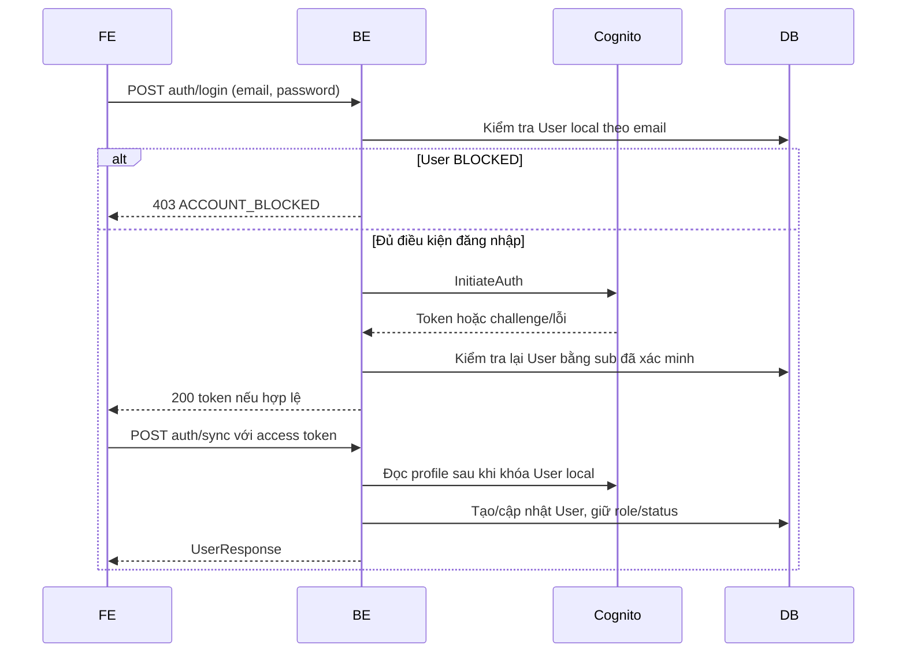

# Flow API — Danh mục và thứ tự gọi cho team

Ngày đối chiếu: **04/11/2026**. Source hiện có **46 endpoint**, gồm 21 endpoint Admin.

## 1. Quy ước

- Base URL local: `http://localhost:8080`; các bảng bên dưới đã bao gồm `/api`.
- **Công khai:** không yêu cầu access token, nhưng vẫn có điều kiện request/Cognito. Refresh cần refreshToken hợp lệ.
- **User:** access token hợp lệ và User local ACTIVE, theo quyền sở hữu dữ liệu; Admin cũng có thể dùng các API bản thân/học/chơi tương ứng.
- **Admin:** thêm role admin từ DB local.
- Dùng `Authorization: Bearer <accessToken>` cho API được bảo vệ; không dùng idToken hoặc refreshToken làm Bearer.
- Object/array/page là body trực tiếp; BE không có envelope success/data chung cho mọi API.
- 204 là body rỗng. Không gọi JSON.parse/response.json cho kết quả này.

## 2. Danh mục 46 endpoint

### 2.1. Auth — 9 endpoint

| # | Method | Endpoint | Quyền | Thành công / tác dụng |
|---|---|---|---|---|
| 1 | POST | `/api/auth/register` | Công khai | 200, message; tạo Cognito User. |
| 2 | POST | `/api/auth/confirm-register` | Công khai | 200, message. |
| 3 | POST | `/api/auth/resend-confirmation` | Công khai | 200, message theo luồng gửi lại mã. |
| 4 | POST | `/api/auth/login` | Công khai | 200, accessToken/idToken/refreshToken/expiresIn. |
| 5 | POST | `/api/auth/sync` | JWT hợp lệ | 200, UserResponse; tạo/cập nhật User local. |
| 6 | POST | `/api/auth/refresh` | Refresh token | 200, bộ token. |
| 7 | POST | `/api/auth/forgot-password` | Công khai | 200, message. |
| 8 | POST | `/api/auth/reset-password` | Công khai | 200, message. |
| 9 | POST | `/api/auth/logout` | Công khai | 200, logoutUrl; không phải chứng minh đã thu hồi JWT BE. |

### 2.2. Topic và học — 4 endpoint

| # | Method | Endpoint | Quyền | Thành công / tác dụng |
|---|---|---|---|---|
| 10 | GET | `/api/topics` | User | 200, array Topic active. |
| 11 | GET | `/api/topics/{topicId}` | User | 200, một Topic active. |
| 12 | GET | `/api/topics/{topicId}/learning` | User | 200, nội dung học và mode màn học. |
| 13 | PUT | `/api/topics/{topicId}/learning/progress` | User | 200, tiến độ xa nhất; body có vocabId. |

### 2.3. Game — 4 endpoint

| # | Method | Endpoint | Quyền | Thành công / tác dụng |
|---|---|---|---|---|
| 14 | POST | `/api/topics/{topicId}/game-sessions` | User | 201, session và questions. |
| 15 | GET | `/api/topics/{topicId}/game-sessions/active` | User | 200 resume; 204 nếu không có phiên. |
| 16 | DELETE | `/api/topics/{topicId}/game-sessions/active` | User | 204; chuyển phiên hiện tại sang ABANDONED nếu có. |
| 17 | POST | `/api/game-sessions/{sessionId}/attempts` | Chủ phiên | 200, kết quả chấm và tiến độ mới. |

### 2.4. Hồ sơ và theo dõi bản thân — 7 endpoint

| # | Method | Endpoint | Quyền | Thành công / tác dụng |
|---|---|---|---|---|
| 18 | GET | `/api/users/me` | User | 200, UserResponse. |
| 19 | PATCH | `/api/users/me` | User | 200, đổi displayName của bản thân. |
| 20 | GET | `/api/users/me/streak` | User | 200, streak hiện còn hiệu lực. |
| 21 | GET | `/api/users/me/progress` | User | 200, topics và tiến độ/checkpoint. |
| 22 | GET | `/api/users/me/game-statistics` | User | 200, các tổng và accuracyRate. |
| 23 | GET | `/api/users/me/game-history` | User | 200, page lịch sử đã kết thúc. |
| 24 | GET | `/api/users/me/game-history/{sessionId}` | Chủ phiên | 200, chi tiết phiên đã kết thúc. |

### 2.5. Leaderboard — 1 endpoint

| # | Method | Endpoint | Quyền | Thành công / tác dụng |
|---|---|---|---|---|
| 25 | GET | `/api/leaderboard/weekly` | User | 200, tuần hiện tại, entries và me. |

### 2.6. Admin — 21 endpoint

| # | Method | Endpoint | Quyền | Thành công |
|---|---|---|---|---|
| 26 | GET | `/api/admin/topics` | Admin | 200, array gồm cả Topic đã ẩn. |
| 27 | POST | `/api/admin/topics` | Admin | 201; multipart name/description/image. |
| 28 | PUT | `/api/admin/topics/{topicId}` | Admin | 200; multipart cập nhật. |
| 29 | DELETE | `/api/admin/topics/{topicId}` | Admin | 204, ẩn Topic. |
| 30 | PATCH | `/api/admin/topics/{topicId}/restore` | Admin | 200, khôi phục Topic. |
| 31 | GET | `/api/admin/topics/{topicId}/vocabularies` | Admin | 200, array gồm cả từ inactive. |
| 32 | POST | `/api/admin/topics/{topicId}/vocabularies` | Admin | 201; JSON word/meaningVi. |
| 33 | PUT | `/api/admin/topics/{topicId}/vocabularies/{vocabularyId}` | Admin | 200; JSON có thể gửi một field. |
| 34 | DELETE | `/api/admin/topics/{topicId}/vocabularies/{vocabularyId}` | Admin | 204, ẩn Vocabulary. |
| 35 | GET | `/api/admin/vocabularies/ipa` | Admin | 200, word/ipa; query word bắt buộc. |
| 36 | POST | `/api/admin/topics/{topicId}/vocabularies/generate-missing-audio` | Admin | 200, thống kê tạo MP3. |
| 37 | GET | `/api/admin/game-configs/global` | Admin | 200, array 4 key. |
| 38 | PUT | `/api/admin/game-configs/global/{configKey}` | Admin | 200, cấu hình sau lưu. |
| 39 | GET | `/api/admin/game-configs/topics/{topicId}` | Admin | 200, array 4 key với hiệu lực. |
| 40 | PUT | `/api/admin/game-configs/topics/{topicId}/{configKey}` | Admin | 200, override sau lưu. |
| 41 | DELETE | `/api/admin/game-configs/topics/{topicId}/{configKey}` | Admin | 204, bỏ một override. |
| 42 | DELETE | `/api/admin/game-configs/topics/{topicId}` | Admin | 204, bỏ override các key hỗ trợ. |
| 43 | GET | `/api/admin/game-configs/audits` | Admin | 200, page audit. |
| 44 | GET | `/api/admin/game-configs/audits/{auditId}` | Admin | 200, chi tiết audit. |
| 45 | GET | `/api/admin/users` | Admin | 200, page User. |
| 46 | PATCH | `/api/admin/users/{userId}/status` | Admin | 200, status; chỉ target Learner. |

## 3. Flow Login → vào ứng dụng



Request Login:

```json
{"email":"learner@example.com","password":"<password>"}
```

Sync không cần body. Sau Sync, dùng role/status từ BE để điều hướng; không tự gán role admin trong trình duyệt. Challenge chưa hoàn tất có thể trả 409, không phải token Login thành công.

## 4. Flow học → CHECKPOINT

1. GET `/api/topics` → chọn Topic.
2. GET `/api/topics/{topicId}/learning` → dùng mode, startVocabId và vocabularies.
3. PUT `/api/topics/{topicId}/learning/progress` khi học đến từ hợp lệ:

```json
{"vocabId":17}
```

4. GET lại learning/progress khi cần xác định trạng thái tiếp theo. Nếu CHECKPOINT_REQUIRED, bắt đầu CHECKPOINT thay vì tự tăng sang từ chưa mở.
5. POST `/api/topics/{topicId}/game-sessions`:

```json
{"mode":"CHECKPOINT"}
```

6. Sau thắng, GET lại learning và `/api/users/me/progress` để cập nhật nhóm được mở. Streak/leaderboard có thể tải lại khi cần.

## 5. Flow tạo game/resume/submit

### Trước khi tạo

- GET active: 200 thì phục hồi; 204 thì có thể tạo phiên mới.
- Nếu đã có phiên, không gửi POST tạo thêm; có thể chọn DELETE active để bỏ rồi mới tạo.
- POST body mode phải là CHECKPOINT/FREE_PLAY/REVIEW. Nếu chưa đủ điều kiện thì xử lý 409, không đổi mode âm thầm rồi vẫn hiển thị là CHECKPOINT.

### Sau khi tạo

POST trả sessionId, topicId, mode, status, batchStartPosition, batchEndPosition, totalQuestions, startedAt và questions. Mỗi question có vocabularyId, meaningVi, scrambledLetters, audioUrl.

**Create response hiện chưa có maxAttemptsPerWord.** GET active có field này và remainingAttempts; dùng nguồn BE để hiển thị lượt chính xác khi Admin cấu hình khác 3, không mặc định 3 là quy tắc cố định.

### Submit đáp án

POST `/api/game-sessions/{sessionId}/attempts`:

```json
{
  "vocabularyId": 19,
  "submittedLetters": ["S", "U", "G", "A", "R"],
  "timeMs": 5000
}
```

- Mỗi phần tử submittedLetters là một chữ tiếng Anh hoặc dấu nối/nháy được hỗ trợ; tối đa 100 phần tử.
- timeMs nếu gửi phải >= 0; BE hiện không tính điểm dựa trên tốc độ từ field này.
- HTTP 200 có thể correct=false. FE không tự coi 200 là trả lời đúng.

Ví dụ đúng một từ nhưng chưa kết thúc phiên:

```json
{
  "sessionId": 31,
  "vocabularyId": 19,
  "correct": true,
  "attemptNumber": 1,
  "remainingAttempts": 2,
  "wordCompleted": true,
  "sessionCompleted": false,
  "sessionWon": null,
  "pointsEarned": 0,
  "totalScore": 0,
  "nextVocabularyId": 20,
  "correctWord": null,
  "currentStreak": null
}
```

Nếu wordCompleted=true và sessionCompleted=false, lấy câu tiếp theo bằng nextVocabularyId. Nếu sessionCompleted=true, dừng gửi attempt và hiển thị kết quả. totalScore ở đây là **điểm của session**, không phải tổng điểm tài khoản.

### Audio

API attempts không trả audioUrl. Dùng questions nhận từ create/resume, chọn theo vocabularyId của câu đang hiển thị rồi phát MP3 khi nhấn loa. URL hết hạn thì lấy lại learning/resume; không tạo session mới chỉ để đổi URL.

## 6. Đọc lịch sử, thống kê và leaderboard

- History list: `?page=0&size=10`, size 1–100, chỉ COMPLETED/FAILED/ABANDONED. List dùng field `isWon`.
- History detail dùng field `won`, có historyComplete, questions, result và attempts. Phiên IN_PROGRESS trả 409; session của người khác trả 404.
- Statistics không nhận userId. accuracyRate = correctAttempts / totalAttempts × 100, làm tròn hai chữ số; không có attempts thì bằng 0.
- Weekly leaderboard: `?limit=10`, 1–100. Có weekStart, weekEndExclusive, timeZone, entries và me. rank có thể null nếu chưa có điểm hoặc là Admin.

## 7. Flow quản trị

| Nhu cầu | Thứ tự gọi |
|---|---|
| Nội dung | GET Admin topics → POST/PUT Topic multipart → GET Vocabulary theo Topic → POST/PUT Vocabulary JSON. |
| Audio thiếu | POST generate-missing-audio → đọc generated/failed → GET lại Vocabulary để lấy URL. |
| Cấu hình chung | GET global → PUT một key kèm configValue và description → dùng response mới. |
| Cấu hình Topic | GET Topic configs → PUT override hoặc DELETE reset → GET lại để xem effectiveValue/source. |
| Audit | GET audits với bộ lọc → GET detail theo auditId. |
| Tài khoản | GET users với bộ lọc → PATCH status → tải lại User, kể cả khi lỗi AWS có thể đã khóa local. |

Query User: page=0, size=20 mặc định; keyword, role, status tùy chọn. Audit: page=0, size=20; scope, topicId, configKey, action, actorUserId, operationId, changedFrom, changedTo tùy chọn.

## 8. Các lỗi FE/QA cần phân biệt

| HTTP / code | Cách hiểu |
|---|---|
| 400 | Request/field/giá trị không hợp lệ. |
| 401 | Token không hợp lệ/hết hạn, chưa Sync hoặc Login sai thông tin, tùy endpoint. |
| 403 ACCOUNT_BLOCKED | Tài khoản bị khóa; kết thúc phiên client và hiển thị message. |
| 403 khác | Không đủ quyền hoặc tài khoản không đủ điều kiện; không mặc định là BLOCKED. |
| 404 | Tài nguyên không tồn tại/không thuộc User; một số thao tác từ điển cũng có thể không tìm thấy IPA. |
| 409 | Xung đột trạng thái: có phiên active, checkpoint chưa mở, sai câu hiện tại, session đã kết thúc, tên/từ trùng. |
| 429 | Giới hạn số yêu cầu; không tự lặp dồn dập. |
| 502/503 | Lỗi tích hợp, credentials/quyền/mạng hoặc dịch vụ ngoài; đọc code/message cụ thể. |
| 204 | Thành công không body; ví dụ không có phiên active hoặc DELETE thành công. |

HTTP body lỗi thường có message, đôi khi có code; lỗi validation/Security không bảo đảm cùng một schema. Lỗi sync Cognito có các code COGNITO_ACCESS_DENIED, COGNITO_CLIENT_ERROR…; xem bảng 06_CHE_DO_VA_TRANG_THAI.md.

## 9. Điểm FE hiện tại cần đối chiếu

Trong gameSessionApi của FE đang đọc, createSession có dự phòng 3 lượt/30 phút và nhánh lỗi CHECKPOINT tự chuyển FREE_PLAY. BE không có quy tắc chung “checkpoint lỗi thì đổi mode” hoặc timeout 30 phút trong đường xử lý game đã rà.

Team cần xác nhận lại UX và mapping: một phiên được tạo FREE_PLAY phải được hiển thị là FREE_PLAY, không trình bày như checkpoint có điểm/streak. Lượt dùng giới hạn snapshot, không lấy con số dự phòng của client làm giá trị nghiệp vụ.
