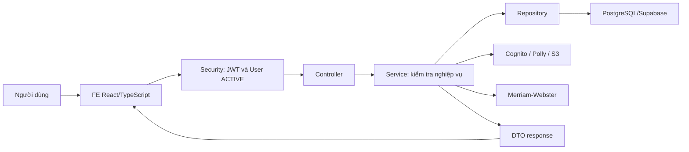
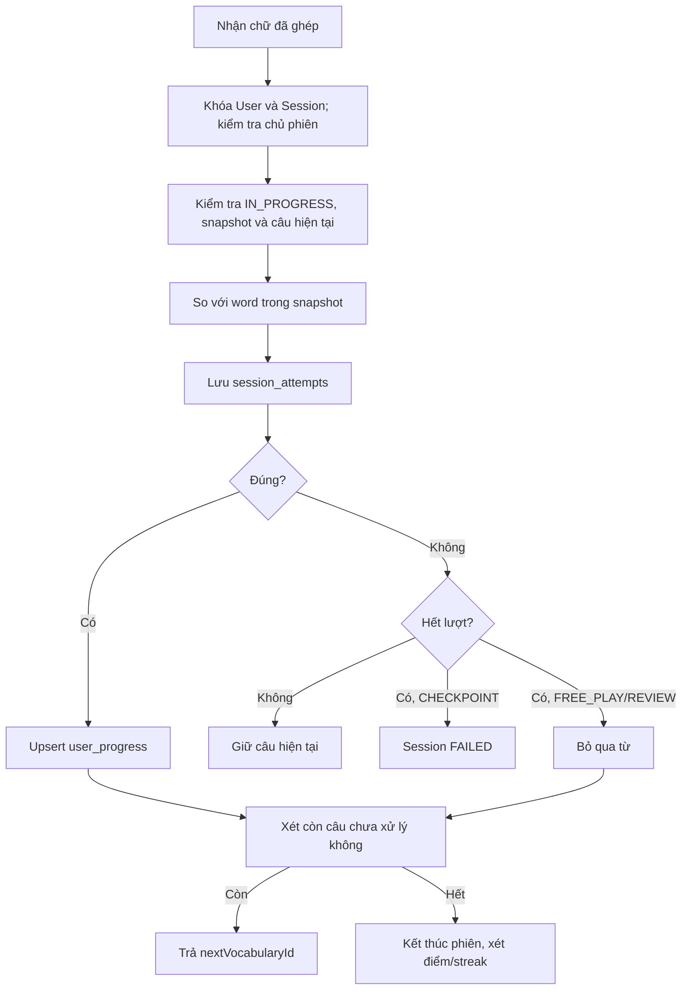

# Flow chức năng — BE xử lý và lưu dữ liệu như thế nào?

Ngày đối chiếu: **04/11/2026**. Phân biệt với flow nghiệp vụ: file này giải thích xử lý phía hệ thống và dữ liệu thay đổi.

## 1. Kiến trúc tổng quát

Chức năng thường đi Controller → Service → Repository. Các service AWS có interface/impl theo phần đang triển khai; không phải mọi request đều gọi đủ tất cả hệ thống ngoài trong sơ đồ.

## 2. Xác thực và đồng bộ User

### Login

Validate request → tìm và khóa User theo email → nếu BLOCKED trả 403 → gọi Cognito → kiểm tra kết quả/challenge → xác minh access token → tìm và kiểm tra User theo sub → trả token nếu hợp lệ.

User chưa có local vẫn có thể Login lần đầu; bước Sync mới tạo User local. Không lấy role do client tự gửi để cấp quyền.

### Sync

1. Nhận sub và access token đã được xác thực.
2. Khóa User theo sub ngay lần truy vấn đầu.
3. Nếu chưa có: đọc Cognito lấy email/name → INSERT ON CONFLICT theo sub → khóa lại bản ghi.
4. Nếu BLOCKED: dừng, không tự chuyển thành ACTIVE.
5. Đọc lại profile Cognito sau khóa; kiểm tra email không trùng User khác.
6. Cập nhật thông tin cần đổi; giữ role/status/createdAt đã có.
7. Commit và trả UserResponse.

Role mặc định khi tạo User local là learner. Tranh chấp email phải được bảo vệ bởi constraint DB; kiểm tra trước ở service không thay thế UNIQUE.

## 3. Chức năng học và lưu tiến độ

### Mở màn học

- Đọc Topic active và Vocabulary active theo orderNo/id.
- Đọc user_topic_learning_progress, xác định từ xa nhất trong danh sách active hiện tại.
- Tính số từ được mở theo nhóm 5 và các checkpoint đã thắng.
- Xác định NEW / LEARNING / CHECKPOINT_REQUIRED / REVIEW.
- Map mỗi từ thành word, meaningVi, IPA, audioUrl và thông tin thứ tự.

Nếu con trỏ cũ trỏ tới từ đã ẩn, service có thể sửa về từ active phù hợp. Đây là một nhánh GET có sửa dữ liệu cũ trong source hiện tại; không phải thao tác thưởng điểm/streak.

### Lưu tiến độ

JWT → khóa User → kiểm tra Topic/từ active và đúng quan hệ → lần đầu phải là từ đầu → lần sau chỉ tiến một từ hoặc xem lại từ cũ → kiểm tra checkpoint đứng trước → lưu furthestVocab/updatedAt.

**Bảng ghi:** user_topic_learning_progress. Chức năng này không tự tạo session_attempts, không cộng điểm và không tự ghi nhận từ đã trả lời đúng trong game.

## 4. Chức năng tạo game session

1. Kiểm tra User ACTIVE và role được chơi; khóa dữ liệu User cần thiết.
2. Kiểm tra Topic active, có từ active và chưa có session IN_PROGRESS trong cùng User/Topic.
3. Chọn câu hỏi theo mode:
   - CHECKPOINT: nhóm đã học đủ nhưng chưa thắng sớm nhất, tối đa 5 từ.
   - FREE_PLAY: toàn bộ từ active, không cần tiến độ học.
   - REVIEW: toàn bộ từ active sau khi học hết và qua mọi checkpoint.
4. Xáo thứ tự câu hỏi và các chữ của từng word.
5. Đọc cấu hình hiệu lực: override active trước, nếu không thì global.
6. Lưu game_sessions với status IN_PROGRESS, score=0, won=false và snapshot.
7. Ký URL audio từ key trong snapshot để trả questions cho FE.

### Snapshot bao gồm gì?

| Dữ liệu | Mục đích |
|---|---|
| question_vocab_ids | Bộ ID và thứ tự câu hỏi của phiên. |
| question_snapshot | vocabularyId, word, meaningVi, scrambledLetters, topicPosition, audioKey. |
| batch_start_position / batch_end_position | Nhóm checkpoint gắn với phiên. |
| max_attempts_per_word | Giới hạn lượt đã chốt. |
| score_enabled_snapshot | Phiên này có bật thưởng điểm không. |
| checkpoint_pass_points_snapshot | Số điểm thưởng đã chốt cho phiên. |
| streak_enabled_snapshot | Phiên này có bật ghi streak không. |

Scrambled letters được sinh từ Vocabulary.word trong code rồi lưu snapshot. Đường chơi hiện tại không truy vấn bảng alphabet/letters riêng để lấy bộ chữ. Bảng chữ cái nếu có trên DB chưa phải nguồn được dùng trong luồng tạo câu hỏi này.

Không trả word nguyên bản trong DTO câu hỏi đang chơi; DTO chỉ có gợi ý nghĩa, chữ xáo trộn, ID và audioUrl. Word đầy đủ vẫn được giữ trong snapshot phía BE để chấm.

## 5. Chức năng submit attempt

### Trình tự quan trọng

1. Payload hợp lệ, User hợp lệ, session thuộc User và còn IN_PROGRESS.
2. Snapshot/cấu hình đủ; chỉ nhận vocabularyId của câu chưa giải quyết đầu tiên.
3. Ghép submittedLetters sau chuẩn hóa, so với word trong snapshot.
4. Lưu attempt, tăng số lần đã dùng của đúng từ.
5. Nếu đúng, upsert user_progress với completed=true; first_completed_at chỉ lấy lần đầu.
6. Áp dụng kết thúc/bỏ qua theo mode.
7. Nếu CHECKPOINT thắng, xét thưởng điểm theo snapshot.
8. Nếu đủ điều kiện, đồng bộ weekly_scores và ghi streak.
9. Trả DTO và commit transaction DB.

Nếu một cập nhật DB quan trọng lỗi, transaction rollback; không cố giữ session đã hoàn thành nhưng mất cập nhật điểm/streak trong cùng giao dịch đó.

### Dữ liệu không bị đảo ngược vì thua/bỏ phiên

user_progress phản ánh từ từng trả lời đúng. Một từ đã đúng có thể vẫn được ghi nhận dù về sau checkpoint thua ở từ khác hoặc User bỏ phiên. Điều này không có nghĩa checkpoint đã được công nhận PASSED.

## 6. Điểm, streak và leaderboard

### Điểm

- session_attempts.points luôn ghi 0 trong xử lý hiện tại.
- Không có điểm thưởng riêng từng từ trong user_progress.
- CHECKPOINT thắng: score bằng điểm snapshot nếu bật điểm, ngược lại 0.
- CHECKPOINT thất bại: 0. FREE_PLAY/REVIEW: 0.
- totalScore trong SubmitAttemptResponse là score của session hiện tại.

Ví dụ Admin đổi thưởng 5 → 10: session đã snapshot 5 vẫn nhận 5; session tạo sau thay đổi mới nhận 10. 5/10 ở đây là ví dụ cấu hình, không phải hằng số bắt buộc của toàn hệ thống.

### Streak

- Gọi recordActivity khi phiên CHECKPOINT kết thúc thắng, có đúng 5 câu hỏi và snapshot bật streak.
- Ngày nghiệp vụ theo Asia/Ho_Chi_Minh.
- Chưa có streak: bắt đầu 1. Cùng ngày: không tăng lần hai. Ngày kế tiếp: tăng 1. Bỏ lỡ ngày: bắt đầu lại 1 khi có hoạt động hợp lệ.
- GET streak tính giá trị đang còn hiệu lực để trả về; không tự reset DB chỉ vì mở trang.
- score_enabled và streak_enabled độc lập: checkpoint 5 từ thắng có thể ghi streak ngay cả khi thưởng điểm bị tắt.

### Điểm tuần

- Khi thắng CHECKPOINT có điểm > 0, synchronizeWeek tính lại tổng điểm hợp lệ trong tuần rồi upsert weekly_scores; không cộng dồn mù mỗi lần gọi.
- Tuần: thứ Hai 00:00 đến thứ Hai kế tiếp, mốc cuối không bao gồm, theo Asia/Ho_Chi_Minh.
- API leaderboard hiện tổng hợp từ game_sessions, lọc mode CHECKPOINT, COMPLETED, won=true, score>0 và User learner/ACTIVE.
- Đồng điểm dùng RANK, ví dụ 1, 1, 3; số hàng top giới hạn bằng vị trí ROW_NUMBER riêng, có sắp ID để ổn định.
- Bảng weekly_scores trống không đủ để kết luận leaderboard lỗi; ngược lại có dòng weekly_scores cũng không thay thế điều kiện lọc thực tế của API.

## 7. Resume, bỏ phiên và đọc lịch sử

**Resume:** tìm session IN_PROGRESS của User/Topic → đọc attempts → validate snapshot → tính CURRENT/PENDING/COMPLETED/SKIPPED, số lượt và next unresolved → ký lại URL audio → trả dữ liệu, không thưởng/ghi attempt.

**Bỏ phiên:** khóa session active → status ABANDONED, won=false, endedAt/lastEventAt → giữ attempts, snapshot và tiến độ từ đã đúng. Không có active thì DELETE vẫn kết thúc an toàn.

**Lịch sử:** list chỉ lấy phiên đã kết thúc; detail kiểm tra chủ phiên, chặn IN_PROGRESS, ưu tiên snapshot và ghép toàn bộ câu với attempts. Thiếu dữ liệu cũ có thể fallback Vocabulary và trả historyComplete=false; không tự giả định dữ liệu fallback là ảnh chụp lịch sử chính xác tuyệt đối.

**Thống kê:** totalSessions đếm các session của User gồm cả phiên chưa kết thúc; wonSessions đếm COMPLETED/won=true ở các mode; tổng điểm chỉ từ CHECKPOINT thắng. Accuracy tính theo lượt trả lời, không theo số từ duy nhất.

## 8. Nội dung, IPA và audio

- Tạo Topic: validate quyền/tên/ảnh → upload ảnh S3 → lưu Topic active.
- Tạo Vocabulary: validate từ/nghĩa/trùng → tra IPA → Polly tạo MP3 → upload S3 → lưu Vocabulary.
- Chỉ đổi nghĩa thì giữ IPA/audio; đổi word mới sinh lại IPA/audio.
- DB lưu object key, response dùng URL có thời hạn. Audio upload mới dùng UUID để tránh ghi đè file phiên cũ tham chiếu.
- Snapshot cũ thiếu audioKey chỉ fallback audio hiện tại khi ID, Topic và word còn khớp. Không khớp thì trả null để tránh phát nhầm từ.
- Backfill chỉ xử lý từ active thiếu key hợp lệ; có thể HTTP 200 nhưng failed>0. Key hợp lệ không chứng minh file còn tồn tại.

Các thao tác S3/Polly/từ điển và DB không có rollback chung như một transaction DB. FE phải giữ form và kiểm tra lại dữ liệu sau lỗi/timeout, tránh tự gửi lặp tạo mới.

## 9. Cấu hình, audit và quản lý tài khoản

**Config:** chỉ hỗ trợ max_attempt_per_word, checkpoint_pass_points, score_enabled, streak_enabled. configValue là String; description bắt buộc. Override active được ưu tiên; tắt override nghĩa là fallback global, không phải tắt tính năng.

**Audit:** BE đặt actor/operationId vào transaction context rồi upsert/delete cấu hình. Việc ghi audit phụ thuộc trigger DB được triển khai đúng; Java đọc audit qua Repository. Cần kiểm tra trigger thực tế khi nghiệm thu, không suy ra chỉ từ sự tồn tại Entity.

**Khóa Learner:** ghi/flush BLOCKED local → gọi Cognito Disable → commit local ngay cả khi lỗi đồng bộ được phân loại. AWS lỗi thì Admin nhận code/message và có thể gửi lại cùng status. Lỗi DB vẫn rollback, không được đánh đồng với lỗi AWS.

**Mở Learner:** Cognito Enable trước → chỉ sau thành công mới đổi local ACTIVE. Nếu DB lỗi sau AWS thành công, cần đồng bộ lại; không trả 200 giả.

## 10. Bảng ghi dữ liệu để team tra nhanh

| Sự kiện | Ghi chính |
|---|---|
| Sync lần đầu | users |
| Học đến một từ | user_topic_learning_progress |
| Tạo game | game_sessions và JSON snapshot |
| Gửi đáp án | session_attempts, game_sessions |
| Trả lời đúng | Thêm/upsert user_progress |
| Thắng checkpoint có điểm | score session, đồng bộ weekly_scores |
| Thắng checkpoint đủ 5 từ, bật streak | user_streaks |
| Admin sửa cấu hình | game_configs; audit qua trigger DB |
| Admin khóa/mở | users và thao tác Cognito riêng |

Đây là các bảng có đường xử lý được đối chiếu trong source, không phải xác nhận danh sách đầy đủ mọi bảng trên Supabase hiện tại.
