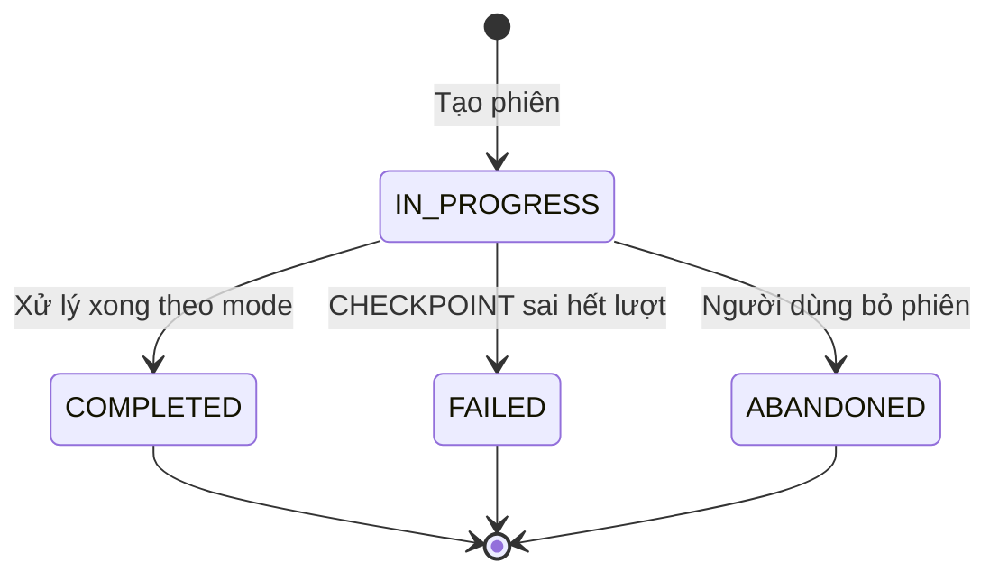

# Giải thích chế độ chơi, trạng thái và thuật ngữ

Ngày đối chiếu: **04/11/2026**. File tra cứu dành cho cả người mới, FE, BE và QA.

## 1. Phân biệt mode và status

- **Mode:** đang thực hiện kiểu hoạt động nào, ví dụ CHECKPOINT hay FREE_PLAY.
- **Status:** đối tượng đó đang ở giai đoạn nào, ví dụ IN_PROGRESS hay FAILED.
- Cùng một chữ có thể xuất hiện ở nhiều đối tượng. Luôn đọc kèm tên DTO/field, không dùng một enum chung cho mọi màn hình.

Ví dụ: một session có `mode=FREE_PLAY`, `status=COMPLETED`, `won=false`. Nghĩa là đã kết thúc chơi tự do nhưng không trả lời đúng tất cả từ; đây không phải dữ liệu mâu thuẫn.

## 2. Ba mode game

| Tiêu chí | CHECKPOINT | FREE_PLAY | REVIEW |
|---|---|---|---|
| Nghĩa | Kiểm tra nhóm từ vừa học để mở tiến trình tiếp. | Chơi tự do để luyện. | Ôn lại toàn Topic đã hoàn thành điều kiện. |
| Điều kiện | Đã học đủ nhóm, nhóm đó chưa thắng. | Topic active có từ active; không cần học trước. | Học hết và thắng mọi checkpoint hiện tại. |
| Bộ từ | Một nhóm tối đa 5 từ. | Toàn bộ từ active của Topic. | Toàn bộ từ active của Topic. |
| Câu hỏi/chữ | Được xáo trộn và lưu snapshot. | Như CHECKPOINT. | Như CHECKPOINT. |
| Số lượt | Theo snapshot max_attempts_per_word. | Theo snapshot. | Theo snapshot. |
| Sai hết lượt một từ | FAILED ngay cả phiên. | Bỏ qua từ, tiếp tục. | Bỏ qua từ, tiếp tục. |
| Hoàn thành | Tất cả từ trong nhóm trả lời đúng trong lượt cho phép. | Mọi từ đã đúng hoặc đã hết lượt. | Mọi từ đã đúng hoặc đã hết lượt. |
| won | True khi thắng nhóm. | True khi tất cả từ từng trả lời đúng. | True khi tất cả từ từng trả lời đúng. |
| Điểm thưởng | Có thể có theo snapshot; có thể 0 nếu tắt điểm. | Luôn 0 trong logic hiện tại. | Luôn 0 trong logic hiện tại. |
| Ghi streak | Chỉ khi thắng đủ 5 từ và bật streak. | Không qua mode này. | Không qua mode này. |
| Mở nhóm học tiếp | Có, nếu đúng checkpoint của nhóm hiện tại. | Không thay thế checkpoint. | Không phải bước mở nhóm mới. |

CHECKPOINT là bài kiểm tra theo nhóm, không phải một trạng thái của session. Không gọi một phiên FREE_PLAY là “checkpoint” trong UI.

### Nhóm cuối Topic ít hơn 5 từ

Topic có 12 từ chia 1–5, 6–10, 11–12. Nhóm 11–12 vẫn là CHECKPOINT hợp lệ và có thể có điểm thưởng khi thắng. Tuy nhiên source ghi streak yêu cầu questionIds.size()==5, nên nhóm 2 từ không tăng streak.

### “Đúng cả checkpoint” nghĩa là gì?

Mỗi từ có thể sai trước rồi đúng trong giới hạn lượt. Không bắt buộc đúng ngay lần đầu. Chỉ cần một từ CHECKPOINT sai đến hết lượt là cả phiên FAILED.

## 3. Trạng thái game session

| status | Ý nghĩa | Có nhận attempt tiếp không? |
|---|---|---|
| IN_PROGRESS | Phiên đang diễn ra. | Có, đúng câu và còn lượt. |
| COMPLETED | Phiên đã xử lý xong theo quy tắc mode. | Không. |
| FAILED | CHECKPOINT đã thua, ví dụ một từ sai hết lượt. | Không. |
| ABANDONED | Người dùng chủ động bỏ phiên qua DELETE active. | Không. |

- Source hiện dùng **ABANDONED**, không dùng CANCELLED cho flow bỏ phiên. Tên hàm FE có thể là cancelSession nhưng giá trị BE vẫn là ABANDONED.
- Chưa có chuyển trạng thái PAUSED hay EXPIRED tự động trong đường xử lý đã rà. Đóng trang/reload không tự đổi status.
- won=false lúc mới tạo chưa phải kết luận thua; khi status IN_PROGRESS, kết quả cuối chưa được chốt.

## 4. Trạng thái của từng câu khi resume

Field `questions[].status` trong GameResumeQuestionResponse:

| Giá trị | Nghĩa |
|---|---|
| CURRENT | Câu chưa xử lý xong đầu tiên, được gửi đáp án lúc này. |
| PENDING | Câu phía sau, chưa đến lượt. |
| COMPLETED | Từ đã có attempt đúng. |
| SKIPPED | FREE_PLAY/REVIEW đã hết lượt mà chưa đúng, nên bỏ qua. |

COMPLETED ở bảng này là **một câu đã đúng**, không tự nói cả session đã COMPLETED. CHECKPOINT đang active không bỏ qua câu để tiếp tục sau khi sai hết lượt; phiên phải FAILED.

## 5. Trạng thái checkpoint trên trang Progress

Field `topics[].checkpoints[].status`:

| Giá trị | Ý nghĩa | Cách hiển thị gợi ý |
|---|---|---|
| LOCKED | Chưa học đủ nhóm và chưa được công nhận đã thắng. | Chưa mở. |
| AVAILABLE | Đã học đủ nhóm, chưa thắng, không có active checkpoint khớp nhóm này. | Có thể kiểm tra. |
| IN_PROGRESS | Có active CHECKPOINT khớp vị trí và tập ID hiện tại. | Tiếp tục. |
| PASSED | Có session CHECKPOINT COMPLETED/won=true khớp tập từ của nhóm hiện tại. | Đã vượt qua. |

BE ưu tiên PASSED → IN_PROGRESS → AVAILABLE → LOCKED khi tính trạng thái nhóm. Trạng thái AVAILABLE không bỏ qua quy tắc chỉ một phiên active trong Topic; nếu đang có FREE_PLAY thì cần xử lý phiên đó trước khi tạo CHECKPOINT.

PASSED không phải status của game_sessions. Session thắng là COMPLETED với won=true; API Progress chuyển dữ liệu đó thành PASSED để hiển thị checkpoint.

## 6. Mode của màn học

Field `LearningResponse.mode` có thể là:

| Giá trị | Ý nghĩa |
|---|---|
| NEW | Chưa có tiến độ học trong Topic; mở nhóm đầu. |
| LEARNING | Đang học tiếp từ trong phần đã được mở. |
| CHECKPOINT_REQUIRED | Đã học đủ một nhóm nhưng còn checkpoint chưa thắng; cần làm checkpoint. |
| REVIEW | Màn học đã đi đến trạng thái xem lại theo kết quả BE. Với Topic có dữ liệu, thường là đã học hết và không còn checkpoint chờ thắng. |

- Learning mode REVIEW không tự tạo session REVIEW. Phải gọi POST game-sessions với mode REVIEW nếu muốn chơi ôn tập.
- Khi CHECKPOINT_REQUIRED, startVocabId/startPosition có thể null. Không tự cộng ID để mở từ mới.
- Topic không có từ active hiện cũng có thể trả Learning mode REVIEW, completed=true và danh sách rỗng. Đây là empty state; không suy ra tạo được game REVIEW vì game yêu cầu có từ.
- furthestPosition của LearningResponse có thể null khi chưa có tiến độ; ở GameProgressResponse nó là số nguyên 0 trong trường hợp tương ứng.

## 7. Kết quả từng từ trong lịch sử

Field `questions[].result` trong GameHistoryQuestionDetailResponse:

| Giá trị | BE kết luận khi nào? |
|---|---|
| UNANSWERED | Không có attempt cho từ này. |
| CORRECT | Có ít nhất một attempt đúng. |
| EXHAUSTED | Không đúng và số attempt đã bằng giới hạn hợp lệ. |
| INTERRUPTED | Không đúng, chưa hết lượt và session ABANDONED. |
| UNKNOWN | Dữ liệu không đủ/không nhất quán để kết luận các trường hợp trên. |

Không tự đổi UNKNOWN thành trả lời sai. historyComplete=false/snapshotAvailable=false cho biết một phần dữ liệu lịch sử cần được hiển thị thận trọng.

## 8. Các field kết quả attempt dễ nhầm

| Field | Cách hiểu đúng |
|---|---|
| correct | Lần gửi hiện tại đúng hay sai. |
| attemptNumber | Đây là lần thứ mấy của từ hiện tại, bắt đầu từ 1. |
| remainingAttempts | Số lượt còn lại theo cấu hình; có thể vẫn >0 khi vừa trả lời đúng. |
| wordCompleted | Không tiếp tục hỏi từ này nữa; có thể vì đúng hoặc vì hết lượt. |
| sessionCompleted | Phiên kết thúc sau lần gửi này, kể cả kết thúc FAILED. |
| sessionWon | null khi chưa kết thúc; true/false khi chốt kết quả. |
| pointsEarned | Điểm thưởng phát sinh ở kết thúc CHECKPOINT; đúng một từ giữa phiên thường là 0. |
| totalScore | Điểm của session hiện tại, không phải tổng điểm tuần/tài khoản. |
| nextVocabularyId | ID câu kế khi từ hiện tại đã xong và phiên còn tiếp tục; null trong các trường hợp khác. |
| correctWord | Hiện được tiết lộ khi từ đã sai hết lượt; null trong nhiều response đúng là bình thường. |
| currentStreak | Chỉ được điền ở lần submit có ghi streak; null không có nghĩa tổng streak của User là 0. |

Ví dụ: correct=true, remainingAttempts=2, wordCompleted=true là hợp lệ. User đã đúng ở lượt đầu nên không cần dùng hai lượt còn lại.

## 9. Role, trạng thái User và nội dung

| Field / đối tượng | Giá trị | Ý nghĩa |
|---|---|---|
| users.role | learner | Người học. |
| users.role | admin | Quản trị viên. |
| users.status | ACTIVE | Tài khoản local được phép dùng chức năng theo role. |
| users.status | BLOCKED | Tài khoản local bị chặn, kể cả có JWT còn hạn. |
| TopicResponse.isActive | true/false | Topic được hiển thị cho người học hay bị ẩn. |
| AdminVocabularyResponse.active | true/false | Từ đang hoạt động hay đã ẩn. |

ACTIVE không có nghĩa được quyền Admin. Trạng thái xác minh/disable của Cognito cũng không phải giá trị để ghi trực tiếp vào users.status. Có tài khoản Cognito nhưng chưa Sync không đồng nghĩa đã có User local ACTIVE.

## 10. Cấu hình và audit

| Trường | Giá trị / ý nghĩa |
|---|---|
| configKey | Chỉ max_attempt_per_word, checkpoint_pass_points, score_enabled, streak_enabled. |
| configValue | String số hoặc String true/false, tùy key. |
| overrideActive=true | Áp dụng cấu hình riêng Topic. |
| overrideActive=false | Giữ override nhưng không áp dụng; fallback global. |
| overrideActive=null | Chưa có override. |
| source=TOPIC | effectiveValue lấy từ override active. |
| source=GLOBAL | effectiveValue lấy từ cấu hình chung active. |
| source=GLOBAL_INACTIVE | Không có nguồn global hiệu lực; effectiveValue có thể null. |
| audit.scope | GLOBAL hoặc TOPIC. |
| audit.action | INSERT, UPDATE hoặc DELETE của cấu hình. |
| operationId | Nhóm các dòng audit của cùng một thao tác, ví dụ reset nhiều override. |

Tắt tính điểm cho Topic: configValue="false", active=true ở key score_enabled. Gửi active=false chỉ tắt override và có thể làm globalValue="true" được áp dụng trở lại.

## 11. Mã lỗi khóa tài khoản và đồng bộ AWS

| code | Ý nghĩa |
|---|---|
| ACCOUNT_BLOCKED | User ứng dụng bị khóa; Login/API nghiệp vụ bị từ chối, FE hiển thị message. |
| COGNITO_ACCESS_DENIED | AWS từ chối thao tác quản trị; cần kiểm tra IAM/credentials phía BE. |
| COGNITO_USER_NOT_FOUND | Không tìm thấy định danh User ở pool đang gọi. |
| COGNITO_POOL_NOT_FOUND | Không tìm thấy pool tại cấu hình/region hiện tại. |
| COGNITO_CLIENT_ERROR | Lỗi SDK/credentials/mạng/timeout cần chẩn đoán thêm. |
| COGNITO_RATE_LIMITED | Cognito giới hạn số yêu cầu. |
| COGNITO_IDENTITY_MISSING | User local thiếu sub hợp lệ. |
| COGNITO_SERVICE_ERROR | Lỗi dịch vụ Cognito khác. |
| COGNITO_STATUS_SYNC_FAILED | Lỗi đồng bộ tổng quát. |

ACCOUNT_BLOCKED là lỗi truy cập của User. Các code COGNITO_* ở API khóa/mở là lỗi đồng bộ thao tác quản trị; chúng không có nghĩa JWT Admin sai. Khi khóa, DB có thể đã BLOCKED dù API trả lỗi AWS.

## 12. Thuật ngữ chung

| Thuật ngữ | Giải thích ngắn |
|---|---|
| Topic | Chủ đề gồm các từ vựng. |
| Vocabulary | Một từ tiếng Anh và nội dung học đi kèm. |
| Session | Một phiên chơi với bộ câu hỏi/cấu hình đã chốt. |
| Attempt | Một lần gửi đáp án cho một từ trong phiên. |
| Snapshot | Dữ liệu được lưu tại thời điểm bắt đầu để phiên không đổi theo nội dung/cấu hình mới. |
| Streak | Chuỗi ngày liên tiếp có hoạt động đủ điều kiện, không phải số lần mở app. |
| IPA | Phiên âm, không phải file âm thanh. |
| Audio key | Định danh object MP3 lưu trong DB/snapshot. |
| audioUrl | URL nghe có thời hạn, tạo từ key để FE phát. |
| weekEndExclusive | Mốc đầu tuần kế tiếp; phiên kết thúc đúng mốc đó thuộc tuần mới. |
| Rank | Thứ hạng theo tổng điểm; đồng điểm có thể cùng hạng. |

## 13. Câu hỏi team thường gặp

**Chơi REVIEW để tăng điểm tuần được không?** Không trong logic hiện tại; điểm thưởng ở CHECKPOINT.

**Chơi FREE_PLAY đúng hết từ có mở REVIEW không?** Không tự thay thế tiến độ học và checkpoint.

**Đã thắng nhưng điểm bằng 0 có phải lỗi?** Chưa chắc; kiểm tra mode và score_enabled/điểm thưởng trong snapshot.

**Thắng checkpoint nhưng không tăng streak?** Kiểm tra số từ có đúng 5 và streak_enabled_snapshot; cùng ngày cũng không tăng lần hai.

**Weekly_scores trống nhưng leaderboard có điểm?** Có thể xảy ra vì API leaderboard đọc từ game_sessions. Cần kiểm tra riêng đường đồng bộ bảng tuần.

**Nhấn loa có làm tăng tiến độ hoặc streak không?** Không; nhấn loa là phát MP3. Lưu tiến độ và ghi streak có điều kiện riêng.

**Người dùng thoát trình duyệt là session bị hủy chưa?** Chưa; cần DELETE active để đánh dấu ABANDONED. Có thể resume nếu còn IN_PROGRESS.

**Có số 3 lượt/30 phút ở FE, vậy BE luôn như thế không?** Không. Lượt lấy theo snapshot; code BE đã rà chưa có cơ chế timeout 30 phút tự kết thúc phiên. Không lấy giá trị dự phòng UI làm quy tắc nghiệp vụ.
